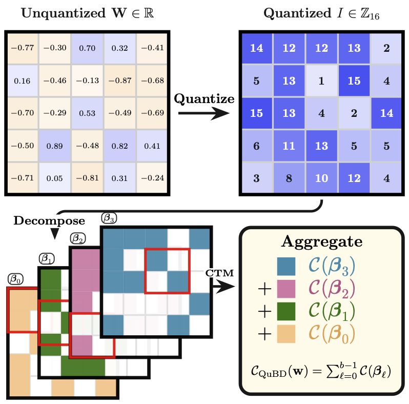

# [NeurIPS 2026] QuBD Complexity 
[](https://arxiv.org/abs/2605.15551)


## Abstract
Training large-scale deep neural networks (DNNs) is resource-intensive, making model compression a practical necessity. The widely accepted ''learning as compression'' hypothesis posits that training induces structure in network weights, which enables compression. Measuring this structure through Kolmogorov-Chaitin-Solomonoff (KCS) complexity is appealing, but existing estimators based on the Coding Theorem Method (CTM) and the Block Decomposition Method (BDM) are limited to small binary objects and do not scale to modern DNNs. We introduce the Quantized Block Decomposition method (QuBD), which extends algorithmic complexity estimation to any $k$-ary object. QuBD first quantizes the network weights to a finite alphabet, then estimates the KCS complexity by aggregating per bit-plane CTM estimates. We show theoretically that QuBD yields a tighter upper-bound on the estimation gap for ideal prefix KCS complexity under bit-plane independence than binarization-based methods. Using QuBD, we study how the algorithmic complexity of neural network weights evolves during training, showing that it decreases as models learn, scales with data budget, increases during overfitting, follows the delayed generalization observed during grokking, and correlates with generalization performance. We further show that algorithmic information resides predominantly in the most significant bit-planes, which can serve as a practical diagnostic for determining appropriate post-training quantization levels. This work offers novel insights into learning mechanisms in DNNs by providing the first scalable, tractable estimates of KCS complexity for large, non-binary objects such as DNN weights.



## Citation
Kindly use the following BibTeX entry if you use the code in your work.

```
@inproceedings{bakhtiarifard2026qubd,
  title     = {{Characterizing Learning in Deep Neural Networks using Tractable Algorithmic Complexity Analysis}},
  author    = {Pedram Bakhtiarifard and Sophia N. Wilson and Mahmoud H. A. Afifi and Jonathan Wenshøj and Raghavendra Selvan},
  booktitle = {Advances in Neural Information Processing Systems (NeurIPS)},
  year      = {2026}
}
```

## Example Usage
Install the required dependencies by running: `pip install torch numpy pybdm`.

```python
import warnings
# pybdm uses deprecated pkg_resources. Suppress only that warning.
warnings.filterwarnings(
    "ignore",
    message=r"pkg_resources is deprecated as an API\.",
    category=UserWarning,
    module=r"pybdm(\.|$)",
)

import torch
from torch import nn
from qbdm.qbdm import measure_complexity

torch.manual_seed(0)

# Train a linear model to reproduce its input.
inputs = torch.randn(256, 16)
targets = inputs

model = nn.Linear(16, 16, bias=False)
optimizer = torch.optim.SGD(model.parameters(), lr=1.0)
loss_function = nn.MSELoss()

for epoch in range(1, 11):
    optimizer.zero_grad()

    predictions = model(inputs)
    loss = loss_function(predictions, targets)

    loss.backward()
    optimizer.step()

    # Measure loss and complexity after the update.
    with torch.no_grad():
        loss = loss_function(model(inputs), targets).item()
        _, bitplane_scores, _ = measure_complexity(
            model, bit_depths=[8], max_workers=1
        )

    complexity = sum(bitplane_scores[8])
    print(f"Epoch {epoch}: loss = {loss:.4f}, complexity = {complexity:.2f}")
```

#### Main experiments
Results in Figure 4 in the paper can be reproduced by running this script:
```
python train.py
``` 


#### Complexity across models
Computes whole-model complexity for a list of timm models, comparing pretrained vs. random weights. Model names are read from `model_names_100.txt`. Results are saved to `results/complexities_100models.json`.

```
python complexity_per_model.py
```

#### Complexity per layer 
Computes bitplane complexity per layer for 5 pretrained models (ResNet18, ResNet50, ViT-B/16, EfficientNet-B0, MobileNetV3), comparing pretrained vs. random weights. Results are saved to `results/complexity_per_layer_5models.json`.

```
python complexity_per_layer.py
```

####  Post-Training Quantization and QuBD Complexity

Evaluates post-training quantization (PTQ) accuracy for 5 pretrained models (ResNet18, ResNet50, ViT-B/16, EfficientNet-B0, MobileNetV3) on the ImageNet-1K validation set. Compares FP32, FP16, and per-channel uniform PTQ at bit depths 1–8. Results are saved to `ptq.json`.

```
python ptq.py
```

Utility module providing quantizer classes (`UniformQuantizer`, `UniformQuantizer_per_channel`) and helper functions (`attach_weight_quantizers`, `detach_weight_quantizers`, `toggle_quantization`) used by `ptq.py`. Not intended to be run directly.

